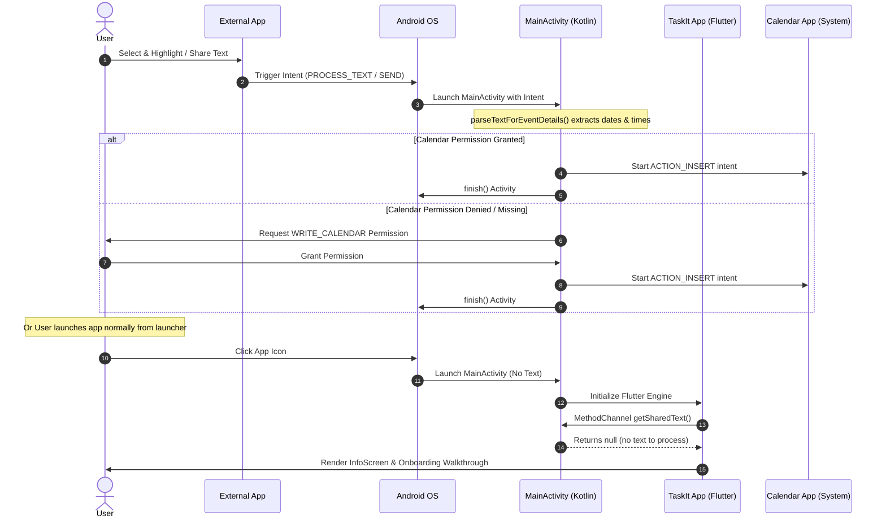

# TaskIt System Design Document

This document provides a comprehensive analysis and design description of the **TaskIt** application. TaskIt is a utility application that allows users to create calendar events and task entries directly from any copied or highlighted text in external Android applications.

---

## 1. Executive Summary

TaskIt bridges the gap between unstructured text in daily apps (e.g., messages, emails, browser pages) and structural planning in Calendar apps. It relies on a hybrid Flutter and Kotlin Android native codebase to achieve system-level integration.

### Core Features
- **Context Menu Integration (`ACTION_PROCESS_TEXT`)**: Highlight text anywhere and select "Create Task" to immediately add a calendar event.
- **Share Sheet Integration (`ACTION_SEND`)**: Copy text and select "Share via TaskIt" from the system share sheet.
- **Natural Language Parsing**: System-level parsing of relative dates (e.g., "tomorrow", "next Friday"), fuzzy dates (e.g., "12th Oct"), and time phrases ("afternoon", "9:30 pm").
- **Interactive Onboarding**: Fluid user onboarding explaining options with device frame mockups and video previews.

---

## 2. System Architecture

The application is split into a **Native Android Container** (Kotlin) and a **Cross-Platform UI** (Flutter).



---

## 3. Native Integration & Manifest Configuration

Android integration is defined in the [AndroidManifest.xml](file:///home/anshul/web/flutter/taskit/android/app/src/main/AndroidManifest.xml) file.

### Intent Filters
`MainActivity` handles three distinct entry points:
1. **App Launcher**: Displays the default entry.
2. **Context Menu (`ACTION_PROCESS_TEXT`)**:
   ```xml
   <intent-filter android:label="Create Task">
       <action android:name="android.intent.action.PROCESS_TEXT" />
       <category android:name="android.intent.category.DEFAULT" />
       <data android:mimeType="text/plain" />
   </intent-filter>
   ```
3. **Share Sheet (`ACTION_SEND`)**:
   ```xml
   <intent-filter android:label="Share via TaskIt">
       <action android:name="android.intent.action.SEND" />
       <category android:name="android.intent.category.DEFAULT" />
       <data android:mimeType="text/plain" />
   </intent-filter>
   ```

### Permissions
The application declares calendar permissions to allow inserting events:
- `android.permission.WRITE_CALENDAR` (Required to redirect to the system calendar)
- `android.permission.READ_CALENDAR`
- `android.permission.INTERNET`

---

## 4. Kotlin Native Core Logic ([MainActivity.kt](file:///home/anshul/web/flutter/taskit/android/app/src/main/kotlin/me/bhaad/taskit/MainActivity.kt))

The core business logic resides in [MainActivity.kt](file:///home/anshul/web/flutter/taskit/android/app/src/main/kotlin/me/bhaad/taskit/MainActivity.kt), which extends `FlutterFragmentActivity`.

### 4.1. Intent Routing Flow
`handleIntent(intent)` intercepts incoming intents and checks the action:
- `ACTION_PROCESS_TEXT` reads `intent.getStringExtra(Intent.EXTRA_PROCESS_TEXT)`.
- `ACTION_SEND` reads `intent.getStringExtra(Intent.EXTRA_TEXT)`.

If the shared text is populated, it kicks off the parsing engine and schedules redirection to the calendar app.

### 4.2. Natural Language Parsing Engine
`parseTextForEventDetails(text)` uses a multi-pass heuristic process to parse the event details:

| Pass | Target | Logic / Patterns | Result |
| :--- | :--- | :--- | :--- |
| **Pass 0** | Full Date-Time Blocks | Matches patterns like `Sun Oct 05 2025 at 05:00 am` via Regex. | Resolves exact timestamp. |
| **Pass 1** | Explicit / Fuzzy Times | Matches hours and minutes (e.g. `10:30 am`, `18:00`) and relative day segments (e.g., `morning` $\rightarrow$ 9:00 AM, `afternoon` $\rightarrow$ 2:00 PM, `evening` $\rightarrow$ 6:00 PM, `noon` $\rightarrow$ 12:00 PM). | Sets hour and minute. |
| **Pass 2** | Relative Dates | Matches keywords: `today`, `tomorrow` (+1 day), `day after tomorrow` (+2 days), and weekday names (e.g., `monday`). | Calculates offset and sets day. |
| **Pass 3** | Fuzzy / Numeric Dates | Matches explicit numeric dates (`yyyy-MM-dd`, `dd/MM/yyyy`) and formats like `12th Oct`. If no year is present, defaults to current year (or rolls forward if already passed). | Resolves year, month, and day. |

### 4.3. Calendar Redirection
The method `redirectToCalendar(title, startTime, endTime, fullText)` processes the redirection:
- **Permission Check**: Checks if calendar access (`WRITE_CALENDAR`) is granted.
- **Request Flow**: Launches the system permission request dialog if missing. If the user denies permission, the activity is closed (`finish()`).
- **Intent Dispatch**: Builds an `Intent(Intent.ACTION_INSERT)` targets `CalendarContract.Events.CONTENT_URI` with the parsed metadata:
  - Title $\rightarrow$ Parsed string.
  - Description $\rightarrow$ Original full text + suffix `(Shared via TaskIt)`.
  - Begin/End Time $\rightarrow$ Resolved milliseconds epoch values.
- **Activity Completion**: Terminates the `MainActivity` activity immediately after dispatching the intent to provide a clean overlay feel.

---

## 5. Flutter-Native Bridge

Communication between Flutter and Kotlin is established via standard MethodChannels defined in [channels.dart](file:///home/anshul/web/flutter/taskit/lib/platform/channels.dart) and implemented in [MainActivity.kt](file:///home/anshul/web/flutter/taskit/android/app/src/main/kotlin/me/bhaad/taskit/MainActivity.kt).

### 5.1. Channel: `app.channel.process.data`
- **Method**: `getSharedText()`
- **Flutter Invocation**: Called inside [splash.dart](file:///home/anshul/web/flutter/taskit/lib/screens/splash.dart)'s initialization flow.
- **Native Action**: Returns the string stored in `sharedText` and resets it to `null`.

### 5.2. Channel: `app.channel.calendar`
- **Method**: `addCalendarEvent(title, startTime, endTime)`
- **Arguments**:
  - `title` (String)
  - `startTime` (Long, UTC millisecond epoch)
  - `endTime` (Long, UTC millisecond epoch)
- **Native Action**: Directly calls `redirectToCalendar()` using the parameters received.

---

## 6. Flutter UI & Screens

The user interface code is organized in the `lib/screens` directory:

1. **[main.dart](file:///home/anshul/web/flutter/taskit/lib/main.dart)**: Sets up transparent system bars for immersive layouts and runs the MaterialApp, pointing first to `SplashScreen`.
2. **[splash.dart](file:///home/anshul/web/flutter/taskit/lib/screens/splash.dart)**:
   - Queries native platform channels for shared text.
   - If text is present, redirects to the native calendar.
   - Otherwise, pushes `InfoScreen` as a replacement page.
   - Implements responsive aesthetics (alpha gradients on Android 11+ / SDK >= 30, solid color gradients on older devices).
3. **[home.dart](file:///home/anshul/web/flutter/taskit/lib/screens/home.dart) (`InfoScreen`)**:
   - Acts as the main application page.
   - Renders a modern layout displaying an optimized calendar GIF/PNG asset.
   - Conditionally adjusts components for user experience based on the detected SDK:
     - On **Android 11+ (SDK >= 30)**: Displays a premium "Get Started" circular arrow action pointing to the tutorial slides.
     - On **Older Platforms**: Displays a "Watch Tutorial" CTA button targeting a YouTube walk-through video via `url_launcher`.
4. **[onboarding.dart](file:///home/anshul/web/flutter/taskit/lib/screens/onboarding.dart)**:
   - Provides a 5-step detailed visual walkthrough using `PageView` and `SmoothPageIndicator`.
   - Supports mixed media slides:
     - Standard vector images showing text highlighting.
     - Immersive video loop slides showing actual interactions inside an asset-drawn Pixel 8 device frame container (`_VideoSlide`).

---

## 7. Testing Strategy

The test coverage in [main_test.dart](file:///home/anshul/web/flutter/taskit/test/main_test.dart) verifies key behaviors by mocking the native channel bridge:

- **Create Task Flow**: Verifies that when a shared task string is found during splash initialization, it invokes `getSharedText()` and routes it to `addCalendarEvent()`.
- **Share Flow**: Confirms proper handling of shared text formats.
- **Launcher Flow**: Confirms that if no shared text is returned (`null`), `addCalendarEvent()` is never called, and the user safely proceeds to the default onboarding view.

---

> [!NOTE]
> In normal operations, the native side processes and redirects to the calendar app before the Flutter engine is fully running. The Flutter MethodChannel fallback ensures that if any timing race occurs, or if state needs to be synchronized post-permission approval, Flutter can complete the interaction gracefully.
